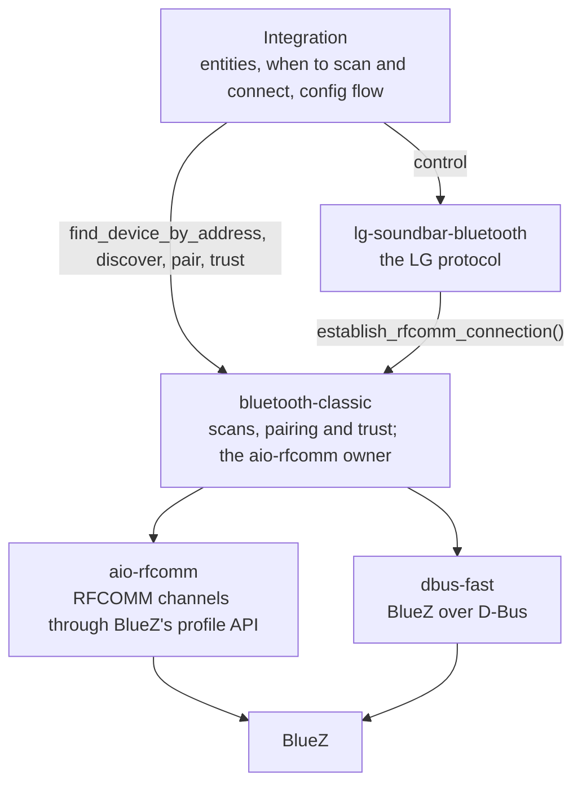

# Architecture

Home Assistant's Bluetooth support covers Bluetooth Low Energy. Some
devices are controlled over Bluetooth Classic instead: LG soundbars such as
the G1 speak a serial protocol over RFCOMM, the Serial Port Profile. This
integration shows one way to support such devices today, and is meant as a
reference for adding Classic support to Home Assistant's `bluetooth`
integration later. Each proposal below stands on its own.

## Layers

| Package | Owns | Knows about LG? |
|---|---|---|
| Integration (this repository) | Entities, when to scan and when to connect, the config flow, the event history in diagnostics | Yes |
| [lg-soundbar-bluetooth](https://github.com/jeverley/lg-soundbar-bluetooth) | Frames, state, the start-up sequence, putting the input back after connecting; a fake soundbar for tests | Yes |
| [bluetooth-classic](https://github.com/jeverley/bluetooth-classic) | Classic discovery, finding one device, pairing and trust (BlueZ over dbus-fast); the one aio-rfcomm owner in the process; `RfcommConnection` and `establish_rfcomm_connection()` | No |
| aio-rfcomm, dbus-fast | RFCOMM channels by service UUID; D-Bus | No |

The integration calls both libraries directly, as Home Assistant
integrations do, with no wrapper module. The one seam is the soundbar
client's link factory: it is handed something shaped like
`RfcommConnection`, so a connection from Home Assistant's `bluetooth`
integration, or the test fake, can replace it without touching the protocol
code.

`bluetooth-classic` stands in for what Home Assistant's `bluetooth`
integration would do for Classic devices, and follows bleak's names where
there is an equivalent (`discover()`, `find_device_by_address()`, `pair()`,
`unpair()`, and `establish_rfcomm_connection()` shaped like
bleak-retry-connector's `establish_connection()`).

## How it behaves, and why

Connecting to the soundbar has side effects: it wakes a soundbar that is
off, moves one that is on to Bluetooth, and takes it from LG's app (the
soundbar keeps only the newest control connection). So the integration
connects as little as it can:

- **On or off comes from a scan.** While not connected, a Classic inquiry
  for the soundbar's address runs every 60 seconds by default. It stops as
  soon as the soundbar answers (within 5 seconds), uses a Classic-only
  discovery filter, and does not wake or move the soundbar.
- **Connections are made on demand:** when the media player or the
  Connected switch is used, or, with the auto-connect option, when the
  soundbar comes on. Home Assistant never reconnects by itself after a
  drop, so it does not fight LG's app.
- **The first request goes out as the link opens.** The soundbar moves to
  Bluetooth 0.12 to 0.7 seconds after a connection opens, and only says
  which input it was on if asked before then. The request is sent from the
  aio-rfcomm owner's own thread the moment BlueZ hands the connection over
  (`write_on_open`), however busy Home Assistant's event loop is; on a real
  soundbar it goes out about 0.1 ms after the link opens. It is the same
  idea as TCP Fast Open: the first request is handed over with the open,
  rather than written once the caller has seen the connection. Unlike TCP
  Fast Open, the bytes are not carried in the handshake itself (RFCOMM's
  cannot carry data), and the aim is a deadline rather than a saved round
  trip.
- **The input is put back** after connecting, and the last input is stored
  so that turning the soundbar on returns to it.
- **One aio-rfcomm owner per process.** aio-rfcomm allows one Bluetooth
  object per process, so `bluetooth-classic` owns it on a thread of its own
  and every caller shares it.

The protocol and what real soundbars do are documented in the library's
[docs/protocol.md](https://github.com/jeverley/lg-soundbar-bluetooth/blob/main/docs/protocol.md).

## Alternatives considered

- **serialx.** An `rfcomm://` handler made the soundbar's link look like a
  serial port, and the soundbar library opened it through serialx. It
  worked, but was dropped: a serial port has settings (baud rate, flow
  control) that mean nothing on RFCOMM, and the abstraction could not
  express sending a request in the same moment the link opens, from outside
  the event loop. An `rfcomm://` handler remains a good fit for devices that
  really are serial ports (serial adapters, OBD-II, GPS), as a separate
  piece.
- **Our own RFCOMM sockets, and our own BlueZ profile code.** Both were used
  and replaced by aio-rfcomm, which connects through BlueZ's profile API, so
  BlueZ finds the service's channel and no channel is stored.
- **bleak.** It is Low Energy only by design; there is no Classic support to
  build on.

## Today and the target

| Stage | Soundbar library | bluetooth-classic | Home Assistant |
|---|---|---|---|
| Today | Connects with `RfcommConnection` | Scans, pairing, the aio-rfcomm owner, `RfcommConnection` | Nothing for Classic |
| aio-rfcomm gains a write on open and an adapter choice | Unchanged | Drops its own write-on-open thread | Nothing for Classic |
| The `bluetooth` integration takes Classic | Gets its connection from Home Assistant | Archived | Owns Classic adapters, scans, pairing and the aio-rfcomm owner; shows Classic devices and links |

## Proposals

Each can be accepted or declined on its own.

1. **Connection slots, in bleak-retry-connector.** Home Assistant's
   connection monitor already shows the soundbar's Classic link, through
   BlueZ, but only if the link was up when the adapter was registered
   (`BleakSlotManager.register_adapter()`): a link made later is never
   noticed, so whether it counts against the adapter's slots depends on
   timing. `BleakSlotManager` could allocate a slot whenever any device on a
   registered adapter becomes connected. That also counts other programs'
   links, such as Bluetooth audio.
2. **aio-rfcomm: a write on open and an adapter choice.** A way to send
   bytes the moment a channel opens, as TCP Fast Open lets a client pass
   its first request with the connect (`MSG_FASTOPEN`,
   `TCP_FASTOPEN_CONNECT`), so callers do not need a thread of their own to
   be in time; and a way to choose the adapter (it uses BlueZ's first
   adapter today).
3. **A Classic scan mode in habluetooth.** Classic discovery and finding one
   device, so Classic devices appear in Home Assistant's Bluetooth pages and
   integrations stop scanning for themselves. `bluetooth-classic`'s
   discovery is the prototype.
4. **Pairing and trust in bleak's BlueZ backend,** which already has
   `pair()`.
5. **The `bluetooth` integration as the aio-rfcomm owner,** handing out
   connections shaped like `RfcommConnection`, as it hands out bleak
   clients.

## Limits and open questions

- **Linux and BlueZ only.** aio-rfcomm has other backends, but this
  integration has only been used with BlueZ.
- **No ESPHome proxies.** Bluetooth proxies carry Low Energy only. Of the
  ESP32 family only the original ESP32 has a Classic radio; a Classic proxy
  would also have to send the opening request itself.
- **Discovery.** Classic devices answer inquiries rather than advertise, and
  background inquiries would interrupt Low Energy scanning, so the scan runs
  when the integration is added. Whether these soundbars also send Low
  Energy advertisements a matcher could use is unconfirmed.
- **The cost of a Classic link.** The controller shares its radio,
  scheduling and connection handles between Classic and Low Energy, so
  counting a Classic link as one slot is a cautious estimate; the exact cost
  per controller is unconfirmed.
- **The name.** `bluetooth-classic` is a generic name for a stand-in; it can
  be offered to the Bluetooth-Devices organisation, or archived once its
  pieces have moved.

## Status

Tested day to day on an LG G1. The integration's standing against Home
Assistant's integration quality scale is in
[quality_scale.yaml](../custom_components/lg_soundbar_bluetooth/quality_scale.yaml).
Both libraries are on PyPI, built and released by CI from their
repositories.
