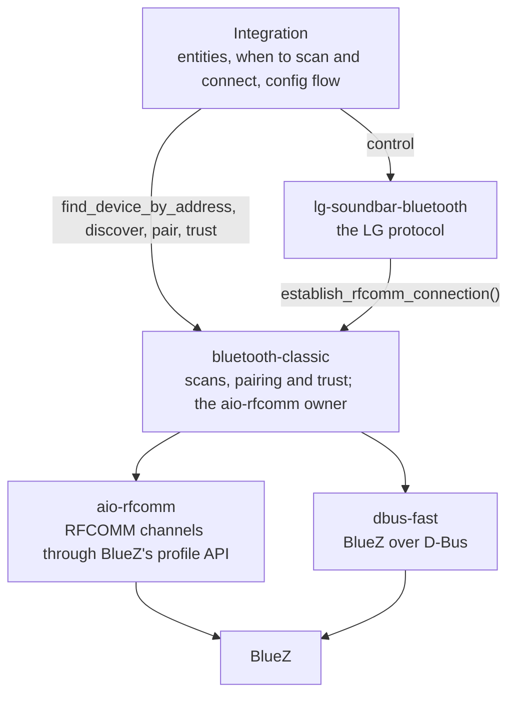
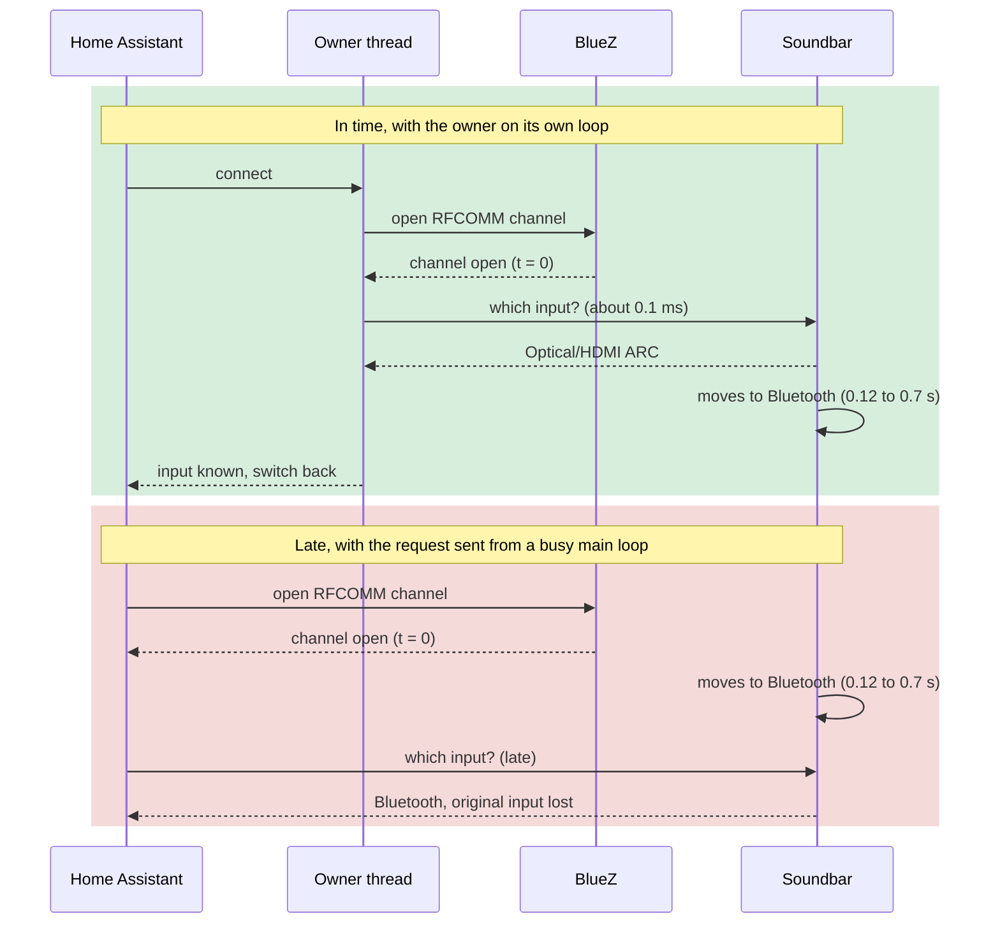
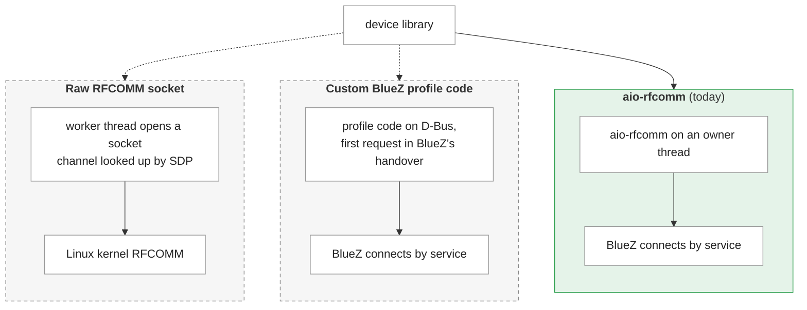
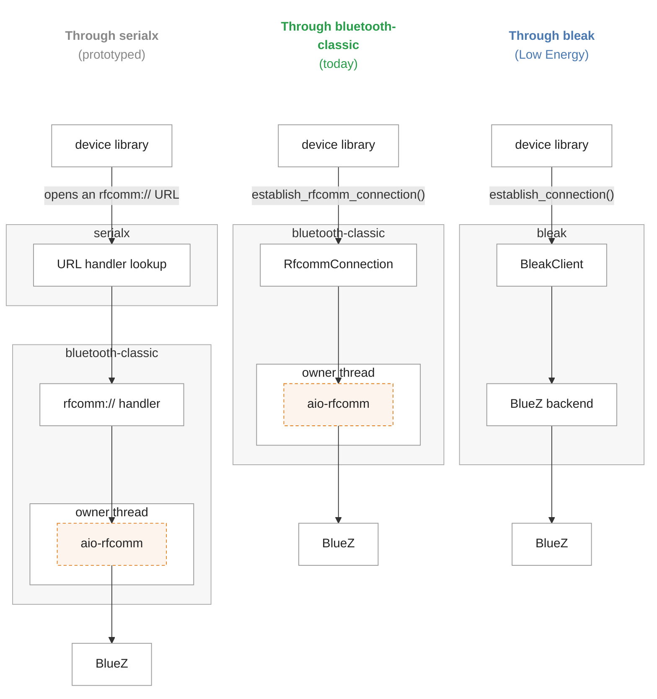

# Architecture

Home Assistant's Bluetooth support covers Bluetooth Low Energy. Some devices
use Bluetooth Classic instead. LG soundbars such as the G1 speak a serial
protocol over RFCOMM, the Serial Port Profile. This integration shows one
way to support them today, and could serve as a reference for adding
Classic support to Home Assistant's `bluetooth` integration later.

## Layers

| Package | Owns | Knows about LG? |
|---|---|---|
| Integration (this repository) | Entities, when to scan and when to connect, the config flow, the event history in diagnostics | Yes |
| [`lg-soundbar-bluetooth`](https://github.com/jeverley/lg-soundbar-bluetooth) | Frames, state, the start-up sequence, putting the input back after connecting, and a fake soundbar for tests | Yes |
| [`bluetooth-classic`](https://github.com/jeverley/bluetooth-classic) | Classic discovery, finding one device, pairing and trust (BlueZ over `dbus-fast`), the one `aio-rfcomm` owner in the process, `RfcommConnection` and `establish_rfcomm_connection()` | No |
| [`aio-rfcomm`](https://github.com/dlech/aio-rfcomm) | RFCOMM channels by service UUID, through BlueZ's profile API | No |
| [`dbus-fast`](https://github.com/Bluetooth-Devices/dbus-fast) | D-Bus, for talking to BlueZ | No |

The soundbar client connects through an `RfcommConnection`, made by its
link factory.

`bluetooth-classic` does for Classic devices what Home Assistant's
`bluetooth` integration might do later. It uses [`bleak`](https://github.com/hbldh/bleak)'s names where there
is an equivalent, such as `discover()`, `find_device_by_address()`,
`pair()` and `unpair()`, and `establish_rfcomm_connection()` is modelled on
[`bleak-retry-connector`](https://github.com/Bluetooth-Devices/bleak-retry-connector)'s `establish_connection()`.

## How it behaves, and why

Connecting to the soundbar wakes it if it is off, moves it to Bluetooth if
it is on, and disconnects other connected devices. So the integration
connects as little as it can.

- While not connected, a Classic inquiry for the soundbar's address every
  60 seconds shows whether it is on. It stops as soon as the soundbar
  answers (within 5 seconds) and does not wake or move it.
- It connects when the media player or the Connected switch is used, or,
  with auto-connect, when the soundbar comes on.
- It never reconnects by itself after a drop.
- After connecting, it puts the input back, and stores the last input for
  turning the soundbar on.

The first request goes out as the link opens:

- The soundbar moves to Bluetooth 0.12 to 0.7 seconds after a connection
  opens, and only reports the input it was on if asked before then.
- The request is sent from the `aio-rfcomm` owner's own thread as soon as
  BlueZ hands the connection over (`write_on_open`), about 0.1 ms after the
  link opens, however busy Home Assistant is.
- It achieves much the same as TCP Fast Open, where the first request is
  passed in with the connect. RFCOMM's handshake cannot carry data, though,
  so the bytes follow it.

Setup pairs with the soundbar, using a temporary agent that accepts only
that soundbar, and marks it as trusted. An untrusted G1 resets the
connection about 75 ms after it opens. What the soundbar offers is stored,
so its entities can be created while it is off.

`aio-rfcomm` allows one Bluetooth object per process, so `bluetooth-classic`
owns it on a thread of its own and every caller shares it.

The protocol and what real soundbars do are documented in the library's
[docs/protocol.md](https://github.com/jeverley/lg-soundbar-bluetooth/blob/main/docs/protocol.md).

## What was prototyped

Two things were prototyped separately: what makes the RFCOMM connection,
and how the soundbar library reaches it. Each combination below was tested
on a real soundbar.

| Connection mechanism | Through a [`serialx`](https://pypi.org/project/serialx/) `rfcomm://` handler | Through `bluetooth-classic`'s `RfcommConnection` |
|---|---|---|
| Raw RFCOMM socket | Tested | |
| Custom BlueZ profile code | Tested | |
| `aio-rfcomm` | Tested | Today |

### The connection mechanism

Three mechanisms made the RFCOMM connection in turn, each handing more of
the work to BlueZ or to a maintained library.

- The raw RFCOMM socket sent the first request from a worker thread as the
  socket opened, in time. It was replaced so BlueZ connects by service,
  with no channel lookup in the library (first `sdptool`, then a custom SDP
  client) and no stored channel.
- The custom BlueZ profile code let BlueZ find the channel. Writing the
  first request in BlueZ's handover on Home Assistant's event loop was late
  at busy start-ups, until the handover moved to a thread of its own, the
  same mechanism every route since has used.
- `aio-rfcomm` replaced the custom profile code, taking the same route
  through BlueZ. It removes custom D-Bus profile code to maintain (such as
  dropping BlueZ's reference to each connection), and it is a maintained,
  cross-platform library from `bleak`'s maintainer.

### How the soundbar library reaches it

`serialx` has no RFCOMM support of its own. The `rfcomm://` handler was
written for this project, in `bluetooth-classic`, and registered with
`serialx` on import. It worked, but only passed bytes through. Its serial
settings went unused, and the first request was an option of the handler's
own. `bluetooth-classic`'s `RfcommConnection` replaced it by choice:

- `bluetooth-classic` wraps `aio-rfcomm` in `RfcommConnection`, opened with
  `establish_rfcomm_connection()`, following the pattern existing Low
  Energy integrations use with `BleakClient` and `establish_connection()`.
  The soundbar library's link factory makes the `RfcommConnection`.
- The soundbar is treated as a Bluetooth device, as Home Assistant treats
  Low Energy devices, scanned, paired and handed a connection by the
  `bluetooth` integration.
- Its protocol and whole lifecycle are Bluetooth.
- An `rfcomm://` handler in `serialx` would still be the better fit for
  devices whose protocol also runs over wired serial, such as
  Bluetooth-to-serial modules, OBD-II adapters and GPS receivers. The one
  written here could be the starting point.

`bleak` was never an option, as it supports Low Energy only.

## Today and the proposed target

| Stage | Soundbar library | bluetooth-classic | Home Assistant |
|---|---|---|---|
| Today | Connects with `RfcommConnection` | Scans, pairing, the `aio-rfcomm` owner, `RfcommConnection` | Nothing for Classic |
| `aio-rfcomm` gains an adapter choice | Unchanged | Lets a machine with several adapters choose one | Nothing for Classic |
| The `bluetooth` integration takes Classic | Gets its connection from Home Assistant | Archived | Owns Classic adapters, scans, pairing and the `aio-rfcomm` owner, off its main event loop, and shows Classic devices and links |

## Proposals

These are independent, and each could be taken up or declined separately.

### 1. Connection slots in `bleak-retry-connector`

Home Assistant's connection monitor shows the soundbar's Classic link, but
only if it was up when the adapter was registered
(`BleakSlotManager.register_adapter()`). A link made later is never
counted, so the slot count depends on timing.

`BleakSlotManager` could allocate a slot whenever any device on a
registered adapter connects, which would also count other programs' links.

### 2. An adapter choice in `aio-rfcomm`

`bleak` takes an adapter, which Home Assistant uses to connect each device
through the best one. Classic devices are usually paired, and a pairing's
key is tied to the adapter that made it, so a Classic connection has to go
through the adapter the device was paired on. `aio-rfcomm` always uses
BlueZ's first adapter (its own code marks choosing one as something to
revisit), so it can do neither. `bluetooth-classic` pairs on the first
adapter for now, so pairing and connecting agree.

A first write inside `aio-rfcomm` is not proposed. On the owner's idle loop
the request already goes out about 0.1 ms after the link opens, so it would
gain little.

### 3. One scanner per adapter in `habluetooth`

- The two kinds of scanning are separate today only because each library
  asks BlueZ for its own kind. BlueZ can already alternate both.
- Low Energy scanning listens passively all the time. A Classic inquiry
  transmits and waits for answers, taking radio time from that listening.
- [`habluetooth`](https://github.com/Bluetooth-Devices/habluetooth) could keep passive Low Energy scanning running and schedule
  short Classic inquiries into it, so the radio budget is decided in one
  place.
- Classic devices would then appear in Home Assistant's Bluetooth pages,
  and integrations would stop scanning for themselves.
- Devices with both radios would need merging, as they can be found both
  ways.

`bluetooth-classic`'s discovery is a prototype for the Classic side.

### 4. Pairing and trust in Home Assistant's Bluetooth libraries

`bleak`'s BlueZ backend has `pair()` for Low Energy devices, and BlueZ pairs
both kinds the same way. `bleak` is Low Energy only by policy, though, so
Classic pairing and trust may belong in `habluetooth` or [`bluetooth-adapters`](https://github.com/Bluetooth-Devices/bluetooth-adapters)
instead.

### 5. The `bluetooth` integration as the `aio-rfcomm` owner

The `bluetooth` integration would hand out connections with
`RfcommConnection`'s methods, as it hands out `bleak` clients. It would run `aio-rfcomm`
on a thread of its own, off Home Assistant's main event loop, so the first
request is not held up by a busy start-up.

## Limits and open questions

Threading is the biggest open question. Bluetooth Low Energy in Home
Assistant runs on its main event loop, but a device that must be asked
something as soon as a connection opens needs the owner on a loop of its
own.

- On the owner's idle loop the request is in time; on Home Assistant's
  loop it was late at busy start-ups (see the diagram above, and what was
  prototyped).
- Whether core would accept a Bluetooth thread of its own is undecided.

Other limits:

- ESPHome Bluetooth proxies carry Low Energy only. Of the ESP32 family,
  only the original ESP32 has a Classic radio.
- Classic devices answer inquiries rather than advertise. The integration's
  own inquiry is short (0.2 to 3.6 seconds on a G1, at most 5 when off),
  but discovering devices not yet set up would need regular 12-second
  scans. So discovery happens when the integration is added.
- How much an inquiry costs Low Energy scanning on a given controller is
  unconfirmed, as is whether these soundbars send Low Energy advertisements
  a matcher could use.
- Classic and Low Energy share the controller's radio and connection
  handles, so counting a Classic link as one slot is a cautious estimate.
- `bluetooth-classic` is a generic name for a temporary library. It could
  be offered to the Bluetooth-Devices organisation, or archived once its
  pieces have moved.

## Status

Tested day to day on an LG G1. The integration's standing against Home
Assistant's integration quality scale is in
[quality_scale.yaml](../custom_components/lg_soundbar_bluetooth/quality_scale.yaml).
Both libraries are on PyPI, built and released by CI from their
repositories.
