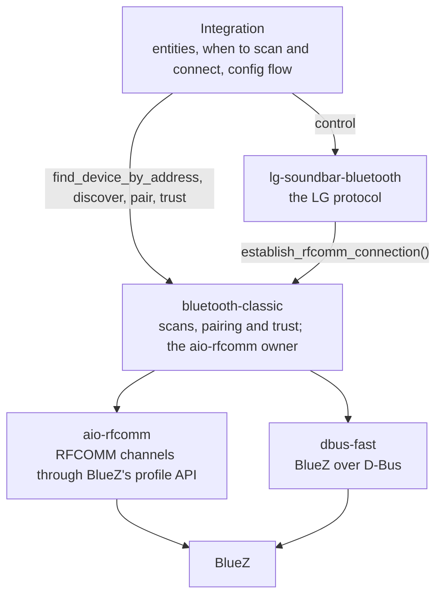
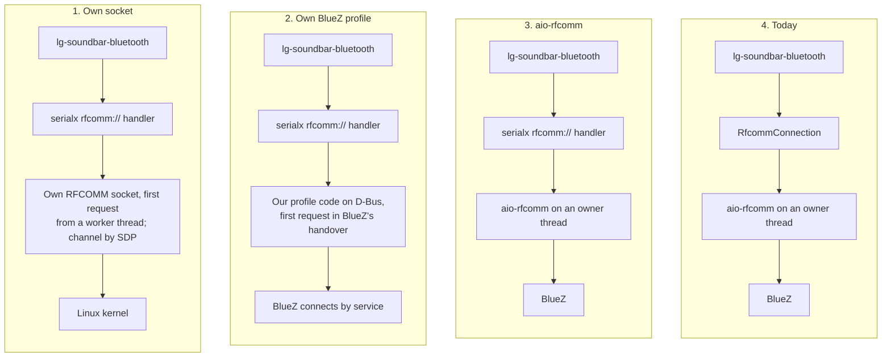

# Architecture

Home Assistant's Bluetooth support covers Bluetooth Low Energy. Some
devices are controlled over Bluetooth Classic instead: LG soundbars such as
the G1 speak a serial protocol over RFCOMM, the Serial Port Profile. This
integration shows one way to support such devices today, and is meant as a
reference for adding Classic support to Home Assistant's `bluetooth`
integration later. Each proposal below stands on its own.

## Layers

| Package | Owns | Knows about LG? |
|---|---|---|
| Integration (this repository) | Entities, when to scan and when to connect, the config flow, the event history in diagnostics | Yes |
| [lg-soundbar-bluetooth](https://github.com/jeverley/lg-soundbar-bluetooth) | Frames, state, the start-up sequence, putting the input back after connecting; a fake soundbar for tests | Yes |
| [bluetooth-classic](https://github.com/jeverley/bluetooth-classic) | Classic discovery, finding one device, pairing and trust (BlueZ over dbus-fast); the one aio-rfcomm owner in the process; `RfcommConnection` and `establish_rfcomm_connection()` | No |
| aio-rfcomm, dbus-fast | RFCOMM channels by service UUID; D-Bus | No |

The integration calls both libraries directly, as Home Assistant
integrations do, with no wrapper module. The one seam is the soundbar
client's link factory: it is handed something shaped like
`RfcommConnection`, so a connection from Home Assistant's `bluetooth`
integration, or the test fake, can replace it without touching the protocol
code.

`bluetooth-classic` stands in for what Home Assistant's `bluetooth`
integration would do for Classic devices, and follows bleak's names where
there is an equivalent (`discover()`, `find_device_by_address()`, `pair()`,
`unpair()`, and `establish_rfcomm_connection()` shaped like
bleak-retry-connector's `establish_connection()`).

## How it behaves, and why

Connecting to the soundbar has side effects: it wakes a soundbar that is
off, moves one that is on to Bluetooth, and takes it from LG's app (the
soundbar keeps only the newest control connection). So the integration
connects as little as it can:

- **On or off comes from a scan.** While not connected, a Classic inquiry
  for the soundbar's address runs every 60 seconds by default. It stops as
  soon as the soundbar answers (within 5 seconds), uses a Classic-only
  discovery filter, and does not wake or move the soundbar.
- **Connections are made on demand:** when the media player or the
  Connected switch is used, or, with the auto-connect option, when the
  soundbar comes on. Home Assistant never reconnects by itself after a
  drop, so it does not fight LG's app.
- **The first request goes out as the link opens.**
  - The soundbar moves to Bluetooth 0.12 to 0.7 seconds after a connection
    opens, and only says which input it was on if asked before then.
  - The request is sent from the aio-rfcomm owner's own thread the moment
    BlueZ hands the connection over (`write_on_open`), however busy Home
    Assistant's event loop is. On a real soundbar it goes out about 0.1 ms
    after the link opens.
  - It is the same idea as TCP Fast Open: the first request is handed over
    with the open, rather than written once the caller has seen the
    connection.
  - Unlike TCP Fast Open, the bytes are not carried in the handshake itself
    (RFCOMM's cannot carry data), and the aim is a deadline rather than a
    saved round trip.
- **The input is put back** after connecting, and the last input is stored
  so that turning the soundbar on returns to it.
- **Setup pairs and trusts.**
  - Pairing uses a temporary agent that accepts only the chosen soundbar.
  - The soundbar is then marked as trusted on the host, as phones do with
    what they pair with: an LG G1 paired but not trusted accepts the
    connection, then resets it about 75 ms later.
  - What the soundbar offers is stored, so entities are created while it
    is off.
- **One aio-rfcomm owner per process.** aio-rfcomm allows one Bluetooth
  object per process, so `bluetooth-classic` owns it on a thread of its own
  and every caller shares it.

The protocol and what real soundbars do are documented in the library's
[docs/protocol.md](https://github.com/jeverley/lg-soundbar-bluetooth/blob/main/docs/protocol.md).

## Routes prototyped

The link has been built four ways, each confirmed on a real soundbar. The
first three all opened through a serialx `rfcomm://` handler; what changed
underneath was what made the connection. Each change moved work to a
better-placed layer, and the timing of the first request shaped all of
them.

| Route | Integration versions | What happened, and why it was replaced |
|---|---|---|
| 1. Own RFCOMM socket | Up to 0.4.24 | A worker thread wrote the first request the moment the socket opened, in time. Replaced so that BlueZ connects by service, as it does for other profiles: no channel lookup of our own (first `sdptool`, then our own SDP client) and no stored channel |
| 2. Own BlueZ profile code | 0.4.25 to 0.4.27 | BlueZ found the channel. Writing the first request in BlueZ's handover on Home Assistant's event loop was too late at a busy start-up, so from 0.4.26 the handover ran on a thread of its own; even so, one busy start-up in three was late. It was also our own D-Bus code, and BlueZ kept its own reference to each connection, which had to be dropped explicitly. Replaced by aio-rfcomm, a maintained library taking the same route |
| 3. aio-rfcomm through serialx | 0.4.28 betas | In time at four start-ups of four. Replaced to follow the Bluetooth pattern (below); serialx only passed bytes, its serial settings (baud rate, flow control) going unused and the first request being an option of the handler's own |
| 4. `RfcommConnection` on aio-rfcomm | 0.4.28 on (as a client shaped like bleak's), reshaped for 1.0 | Today's design: a byte stream, with the first request sent as the link opens, from the owner's thread |

**Why route 4 leaves serialx.** It is a choice, not a limitation:

- The soundbar is treated as a Bluetooth device, as Home Assistant treats
  Low Energy devices: scanned, paired, and handed a connection by the
  Bluetooth integration.
- That fits this device: its protocol only exists over Bluetooth, and so
  does its whole lifecycle.
- serialx worked, and could gain a first write on open.
- serialx stays the better fit for devices whose protocol also runs over
  wired serial (Bluetooth-to-serial modules, OBD-II adapters, GPS
  receivers), where the user picks a port. Both can coexist.

bleak was not an option: it is Low Energy only by design.

## Today and the proposed target

| Stage | Soundbar library | bluetooth-classic | Home Assistant |
|---|---|---|---|
| Today | Connects with `RfcommConnection` | Scans, pairing, the aio-rfcomm owner, `RfcommConnection` | Nothing for Classic |
| aio-rfcomm gains an adapter choice | Unchanged | Lets a machine with several adapters choose one | Nothing for Classic |
| The `bluetooth` integration takes Classic | Gets its connection from Home Assistant | Archived | Owns Classic adapters, scans, pairing and the aio-rfcomm owner, off its main event loop; shows Classic devices and links |

## Proposals

Each can be accepted or declined on its own.

1. **Connection slots, in bleak-retry-connector.**
   - Home Assistant's connection monitor already shows the soundbar's
     Classic link, through BlueZ, but only if the link was up when the
     adapter was registered (`BleakSlotManager.register_adapter()`).
   - A link made later is never noticed, so whether it counts against the
     adapter's slots depends on timing.
   - Proposed: `BleakSlotManager` allocates a slot whenever any device on a
     registered adapter becomes connected. That also counts other
     programs' links, such as Bluetooth audio.
2. **aio-rfcomm: an adapter choice.** It uses BlueZ's first adapter today;
   a machine with several should be able to choose (aio-rfcomm's own code
   marks this to revisit).
   - A first write inside aio-rfcomm, in the same step as the handover, is
     not proposed: on the owner's idle loop the request already goes out
     about 0.1 ms after the link opens, so it would gain little. What
     matters is a loop that is not busy (below).
3. **One scanner per adapter in habluetooth, for both kinds of scanning.**
   - Today the two are separate only because each library asks BlueZ for
     its own kind: Home Assistant for Low Energy, `bluetooth-classic` for
     Classic. BlueZ can already alternate both in one discovery.
   - The radio still treats them differently: Low Energy scanning listens
     for advertisements, and can run passively all the time; a Classic
     inquiry transmits and waits for discoverable devices to answer, taking
     radio time from that listening.
   - Proposed: habluetooth keeps passive Low Energy scanning running and
     schedules short Classic inquiries into it (targeted checks such as the
     soundbar's on/off scan, and general scans when a device is added), so
     the radio budget is decided in one place. Classic devices then appear
     in Home Assistant's Bluetooth pages, and integrations stop scanning for
     themselves.
   - Devices with both radios would be merged, as they can be found both
     ways, sometimes under different addresses. `bluetooth-classic`'s
     discovery is the prototype for the Classic side.
4. **Pairing and trust in Home Assistant's Bluetooth libraries.** bleak's
   BlueZ backend has `pair()` for Low Energy devices, and BlueZ pairs both
   kinds the same way; but bleak is Low Energy only by policy, so Classic
   pairing and trust may belong in habluetooth or bluetooth-adapters
   instead.
5. **The `bluetooth` integration as the aio-rfcomm owner,** handing out
   connections shaped like `RfcommConnection`, as it hands out bleak
   clients. It would run aio-rfcomm off Home Assistant's main event loop,
   on a thread of its own, so the first request is not held up by a busy
   start-up.

## Limits and open questions

- **No ESPHome proxies.** Bluetooth proxies carry Low Energy only. Of the
  ESP32 family only the original ESP32 has a Classic radio; a Classic proxy
  would also have to send the opening request itself.
- **Discovery.** Classic devices answer inquiries rather than advertise.
  - The integration already runs a short, targeted inquiry for its own
    soundbar every minute. It stops as soon as the soundbar answers (0.2 to
    3.6 seconds on a G1, at most 5 when it is off). While it runs, the
    controller shares its radio time with Low Energy scanning.
  - Discovering soundbars that are not set up would need general inquiries
    on a schedule, as long as the 12-second scan setup runs: a much larger
    share, for one setup step. So discovery runs when the integration is
    added.
  - Unconfirmed: how much a short inquiry costs Low Energy scanning on a
    given controller, and whether these soundbars also send Low Energy
    advertisements a matcher could use.
- **Off the main event loop.** Bluetooth Low Energy in Home Assistant runs
  on its main event loop. A device that must be asked something the moment
  a connection opens needs the owner on a loop of its own:
  - On the owner's own idle loop, the request goes out about 0.1 ms after
    the link opens.
  - On Home Assistant's loop at a busy start-up, it was late (route 2
    above).
  - Whether core accepts a Bluetooth thread of its own is the main open
    question for Classic support.
- **The cost of a Classic link.** The controller shares its radio,
  scheduling and connection handles between Classic and Low Energy, so
  counting a Classic link as one slot is a cautious estimate; the exact cost
  per controller is unconfirmed.
- **The name.** `bluetooth-classic` is a generic name for a stand-in; it can
  be offered to the Bluetooth-Devices organisation, or archived once its
  pieces have moved.

## Status

Tested day to day on an LG G1. The integration's standing against Home
Assistant's integration quality scale is in
[quality_scale.yaml](../custom_components/lg_soundbar_bluetooth/quality_scale.yaml).
Both libraries are on PyPI, built and released by CI from their
repositories.
